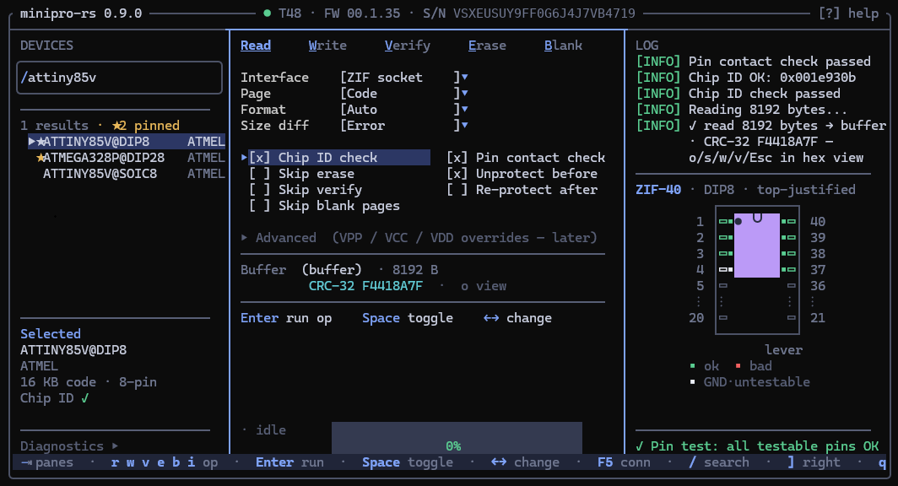
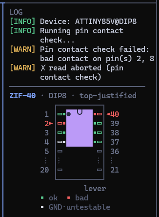
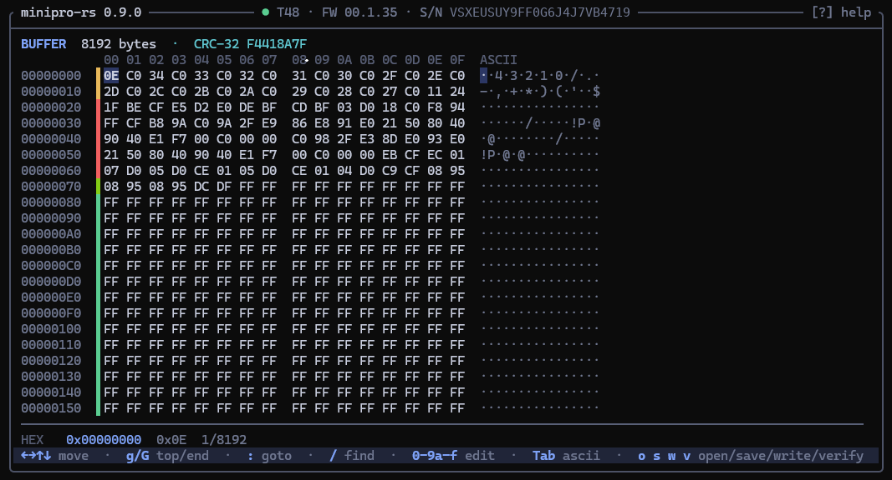
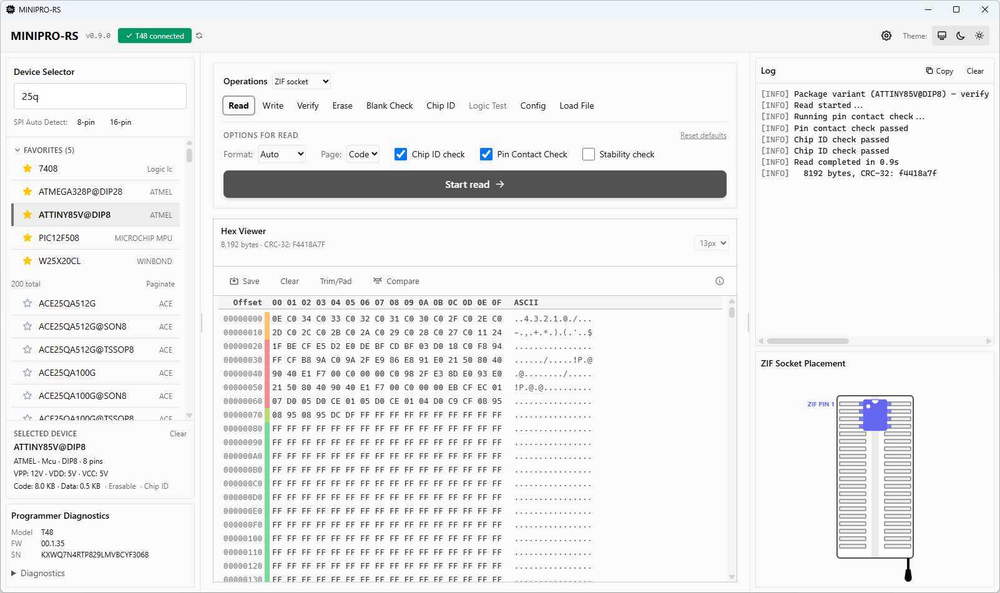
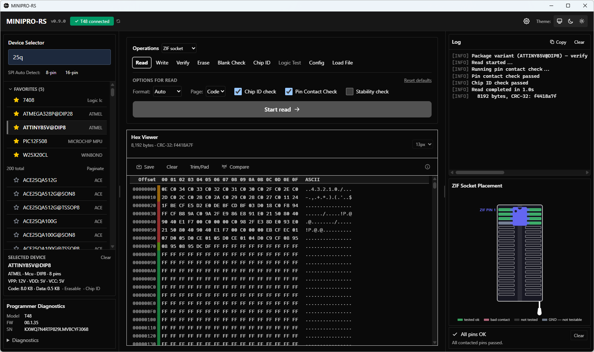
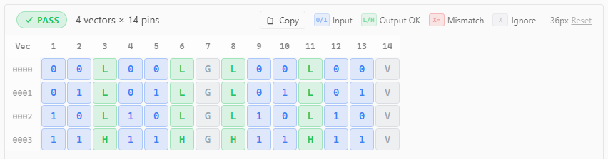
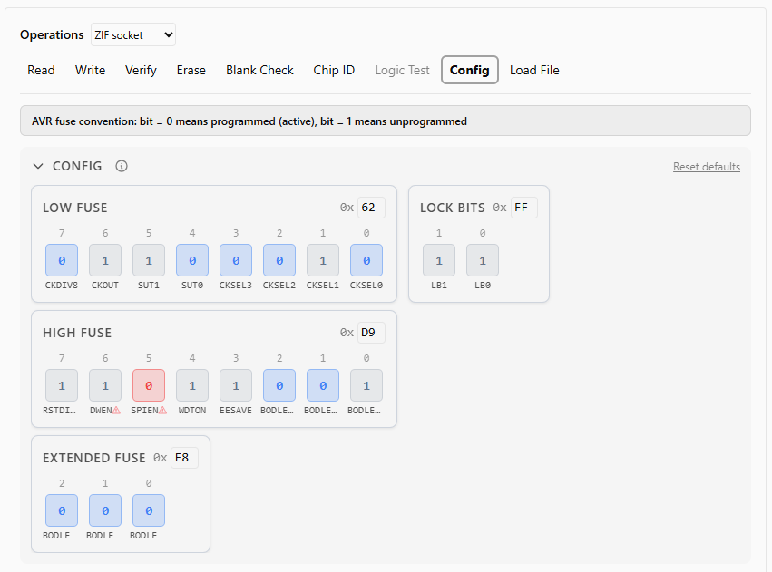
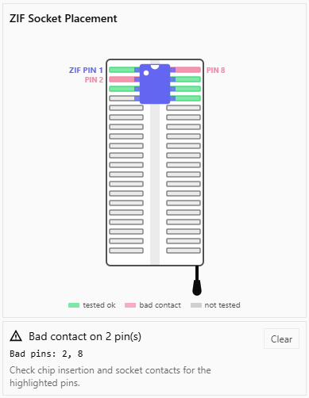
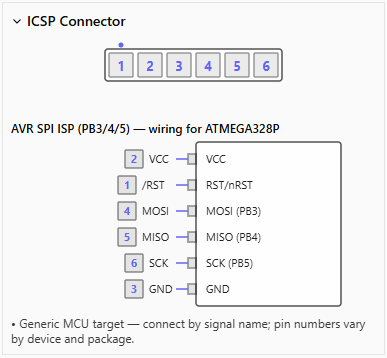
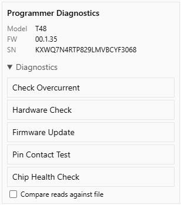

<p align="center">
  
</p>

# minipro-rs

[](https://gitlab.com/arcturus8081/minipro-rs/-/pipelines)
[](https://github.com/Arcturus808/minipro-rs/releases)
[](LICENSE)
[%20%7C%201.88%2B%20(GUI)-orange.svg)](https://www.rust-lang.org)
[](https://github.com/sponsors/Arcturus808)

A Rust reimplementation of [minipro](https://gitlab.com/DavidGriffith/minipro) — an open-source program for controlling XGecu's TL866xx/T48/T56/T76 series of chip programmers.

> **Status:** CI/CD pipeline fully operational — clippy, fmt, tests, Linux/Windows release builds, and all package jobs (`.deb`, `.rpm`, `.msi`, shell completions) passing on every commit. macOS builds are available via [GitHub Actions](https://github.com/Arcturus808/minipro-rs/releases) (see [macOS support](#macos-support)).

> **Bug reports & hardware test results:** [open an issue on GitLab](https://gitlab.com/arcturus8081/minipro-rs/-/issues)

> **This is a spare-time project.** Bug reports and hardware test results are welcome. Please be patient with response times (days to weeks, not hours). For urgent issues, consider contributing a PR — the codebase is well-structured and the [architecture is documented](#architecture-plan). The [GitHub repo](https://github.com/Arcturus808/minipro-rs) is a mirror for release builds only; all issues and merge requests should go to [GitLab](https://gitlab.com/arcturus8081/minipro-rs).

---

## GUI — MINIPRO-RS (Tauri + Svelte)

A native desktop GUI is included in the `gui/` directory. It is built with **Tauri v2** + **Svelte 5** + **Tailwind CSS** and ships as a single `.msi` / `.exe` installer on Windows. The installer includes the full 30,000+ device database (`infoic.xml` / `logicic.xml`) — no separate download needed.

A terminal UI (`minipro-tui`) is included — a ratatui-based three-pane interface covering the six core operations: read / write / verify / erase / blank check / chip ID. Device search supports persistent favorites (pinned, model-filtered) and manufacturer display; reads land in a full-screen **hex buffer editor** — entropy gutter, overtype editing with undo, find with hex/ASCII patterns, and write/verify straight from the buffer, so a read→patch→write-back loop never leaves the terminal. A full-screen **config editor** (`c` key) covers MCU fuse/lock/user-id fields and the 25-series SPI status register with nibble-level hex editing. It ships alongside the `minipro` CLI in release binaries — useful over SSH or on headless setups where a webview GUI isn't practical. Logic-test ops and voltage overrides are not in the TUI yet — use the CLI or GUI for those. See `docs/TUI-PLAN.md` for the design and `docs/TUI-INTERNALS.md` for how it works.







### Screenshots

**Light theme:**



**Dark theme:**



### Features

**Core operations:**
- Read / Write / Verify / Erase / Blank Check / Chip ID / Logic Test / Config
- **Logic IC identify**: automatically identify an unknown logic IC by testing it against all database entries with a matching pin count. CLI: `minipro --logic-identify --pin-count 14 [--vcc 3.3]` (VCC optional — defaults to each candidate's database value). GUI: "Select a logic IC" mode in the Logic Test tab with pin count selector, VCC dropdown, and Identify button — results show only passing matches with Select and favorite buttons
- **Structured logic test grid**: color-coded zoomable grid (Ctrl+Scroll) for logic IC test results — blue=input, green=output-pass, red=mismatch, gray=ignore. Copy button exports TSV for spreadsheets or forum posts. CLI: `minipro -p 74HC00 -T` prints a formatted text table


- **SPI flash auto detect**: identify an unknown SPI NOR chip by its JEDEC ID without selecting a device first — insert the chip and run it. CLI: `minipro -a` (or `-a 0` 8-pin / `-a 1` 16-pin) prints `Autodetecting device (ID:0xXXXX)` plus matching database names. GUI: "Auto Detect" buttons (8-pin / 16-pin) in the device selector list clickable matches. On TL866II+ the GUI runs the pin-contact check automatically first (poor contact yields garbage IDs); works on T76, implemented on T56 but gated in the GUI pending hardware validation. Requires `algorithm.xml` on T56/T76
- **Native T56/T76 algorithm provisioning** — `minipro --download-algorithms` downloads the official XGPro setup archives (pinned SHA-256 checksums), extracts the FPGA bitstreams and programmer firmware images, and generates a validated `algorithm.xml` — pure Rust, no bash/bsdtar/XGPro install needed (so it works natively on Windows). Required once before any T56/T76 chip operation; see [T56 / T76 FPGA algorithm support](#t56--t76-fpga-algorithm-support). The same command also fetches both pinned TL866A/CS firmware images (MiniPro 6.82 and 6.85) from the legacy MiniPro installers
- **Write with auto-erase and auto-verify**: automatically erases before writing and verifies afterward (skippable)
- **Read-to-memory**: chip reads go directly to the hex viewer — no immediate file save required
- **Multi-pass stability check** (GUI): opt-in "Stability check" checkbox reads the chip 5 times and compares passes using the health-check analysis; stable reads proceed normally, unstable reads save the majority-vote consensus image with an unstable-byte warning in the log
- **Chip ID verification**: automatic chip ID read and comparison before read/write/erase/verify; fails with clear mismatch message if inserted chip doesn't match selected device; `-x` / `--skip-id` CLI flag to skip in read mode (rejected for write/erase, matching upstream); `-y` / `--continue-id` to warn but continue on mismatch; GUI checkbox to bypass
- **"Size diff" handling**: Error / Warn / Ignore modes when file size doesn't match device memory size
- **ICSP programming**: in-circuit programming via the programmer's ICSP header instead of the ZIF socket — CLI `-i` (ICSP with VCC) or `-I` (without VCC); GUI: mode dropdown in the operations panel (ZIF socket / ICSP / ICSP no VCC). Devices marked ICSP-only in the database auto-enable it

**Hex viewer & analysis:**
- **Hex viewer** with Save, Open Folder, and Clear buttons — **virtualized rendering** for instant load/clear of large files; now with **in-place editing**: click any hex byte or ASCII character to edit, with type-through overflow and keyboard navigation (arrows, Enter, Escape, Backspace)
- **Standard hotkeys** — Ctrl+S (save), Ctrl+C/V (copy/paste bytes), Ctrl+A (select all), Ctrl+Z/Shift+Z/Y (undo/redo), Ctrl+Home/End (jump to start/end), Tab (switch hex/ASCII panes), Ctrl+G (go to offset)
- **Find/search** — Ctrl+F opens find dialog with hex and ASCII search modes. Match highlighting with F3/Shift+F3 navigation. Context-sensitive F3 navigates find matches or diff results (whichever was last activated)
- **Entropy indicator** — per-row Shannon entropy bar in the gutter between offset and hex columns. Green=uniform/repetitive data, red=high entropy (random/encrypted/compressed). Toggle in Settings (off by default)
- **Smart firmware diff** — compare the hex viewer buffer against a reference file with a single click. Byte-aligned comparison with three-way tail classification: differing bytes highlighted in red, trailing erase-value padding shown in gray (ignored), and anomalous non-padding data beyond the shorter buffer flagged in amber with a warning banner. Navigate between diffs with Prev/Next buttons or F3/Shift+F3. CLI: `minipro --diff fileA fileB [--erase-value 0xFF]`
- **Manual trim/pad** — "Trim/Pad" button in hex viewer toolbar. Trim removes trailing fill bytes; Pad extends to a target size. Fill byte dropdown supports 0xFF (NOR flash) and 0x00 (EEPROM/NAND)
- **Unsaved changes protection** — Read and Open operations prompt before replacing the hex buffer if pending edits or unsaved applied changes exist, preventing accidental data loss
- **Help overlays** — hex viewer has ?/F1 key and "i" toolbar icon for keyboard shortcuts and feature reference; config/fuses panel has "i" icon explaining fuse basics, dangerous fuses, and lock bits

**Batch programming:**
- **Batch programming** — program multiple identical chips with the same firmware image. CLI: `minipro -p DEVICE -w file.bin --batch [N]` prompts to insert the next chip after each successful write + verify. GUI: "Batch Mode" toggle in the write panel with "Next Chip" / "Retry" / "Stop Batch" buttons and live pass/fail counter
- **Auto-incrementing serial numbers** — inject a unique serial number into each chip during batch programming. CLI: `--serial-start 1 --serial-addr 0x1FF0 --serial-width 4 --serial-format bin --serial-endian little --serial-step 1 --serial-checksum none`. Supports binary (little/big endian), ASCII (zero-padded decimal), and BCD formats with optional XOR or CRC-8 checksum. GUI: collapsible "Serial Number" section in batch options with live preview showing serial range
- **Serial overflow detection** — errors if the serial value exceeds the width's max (e.g., 0xFFFF for 2-byte) instead of silently truncating. CLI checks before batch start; GUI shows live warning and blocks start

**MCU support:**
- **Fuse and lock-bit editor** (Config tab): auto-populated from database defaults when a device is selected; read/write MCU configuration bytes with checkbox UI and direct hex input; fuses and lock bits displayed side-by-side; raw user-id bytes shown on devices that have them
- **SPI status register access** (25-series NOR): read and write the on-chip status register (BP block-protect, SRP/SRWD, WEL, WIP) — CLI: `minipro -p W25X20CL --spi-status` prints the byte plus a bit decode, `--spi-status-write 0x04` writes and shows the read-back; GUI: hex field + bit toggles in the Config panel with a non-volatile-BP warning. `minipro -u` (protect off) clears BP bits if a write leaves the chip protected. Verified on T76, TL866A, and T48
- **Voltage and OVC overrides** — CLI `-o KEY=VALUE` tweaks per-device parameters before transactions (`vpp`/`vdd`/`vcc` voltage selection; `ovc_level=1-9` raises the VCC over-current trip point for in-circuit targets that load the rail — T76 also honors `T76_OVC_LEVEL`)
- **Bit-level fuse decoder**: each fuse/config byte is displayed as a grid of clickable bit cells (MSB→LSB) with named fields and descriptions. Click a bit to toggle it — hex value updates automatically. Covers all 18 AVR config variants (sourced from avr-libc and Microchip datasheets) and all database-referenced PIC config variants (PIC10F/PIC12F5 baseline 12-bit, PIC12F/PIC16F mid-range 14-bit, PIC16F baseline 12-bit, PIC18F 16-bit packed words, sourced from gputils and Microchip datasheets). Dangerous bits (RSTDISBL, SPIEN, JTAGEN, DWEN) are highlighted in red. A few PIC configs with database/datasheet mask discrepancies fall back to hex-only input — see [XGPro Database Discrepancies](docs/XGPRO-DATABASE-DISCREPANCIES.md)


- **OSCCAL calibration preservation**: for PIC microcontrollers with `osccal_save=1`, the factory RC oscillator calibration word is automatically saved before erase and restored afterward, preventing clock accuracy loss

**Safety features:**
- **Lock-bit protection safeguards**: warns before read/write when lock bits indicate protection is active
- **Package variant warnings**: warns when `@DIP8`/etc. variants are selected, as they often have incorrect protocol configs
- **No-chip-ID warning**: yellow banner when the selected device lacks chip ID support, reminding user to verify correct chip insertion
- **Pin contact check** — tests ZIF socket contact before operations (read, write, verify, erase, blank check, chip ID, config/fuse read/write). Bad pins are highlighted on the ZIF socket diagram and the operation is aborted. CLI: `-z` / `--pin-check` runs before the requested operation (e.g., `minipro -p ATmega328P -w firmware.hex -z`); failures are annotated with the ZIF position (e.g., `Bad contact on pin: 4 (ZIF pin 24)`). GUI: "Pin Contact Check" checkbox in the operations panel (default on, matching XGPro's "Pin Detect"). Supported on TL866II+, T48, and T76 (plain DIP parts only on T76); disabled on TL866A/CS and T56, and in ICSP mode. On the TL866II+ the GUI runs the check automatically before SPI autodetect — autodetect is aborted if bad pins are found, since poor contact produces garbage JEDEC IDs


- **Chip health check** — flags marginal or degrading chips without writing anything: reads the chip ID (~20×) and the full memory N times (default 5), then analyzes how passes disagree (unstable-byte counts, worst 4 KiB regions, flip direction, periodic spacing) to produce a `Stable` / `Marginal-ID` / `Marginal-Data` / `Incomplete` / `Transport-Error` verdict. `--reference FILE` compares the effective image against a known-good file, catching deterministic corruption that repeated reads can't (`Reference-Mismatch` verdict, exit code 5). A majority-vote consensus image reconstructs the best-effort correct data and can be saved for recovery. CLI: `minipro -p DEVICE --health-check [N] [--consensus-out FILE]`. GUI: "Chip Health Check" button in Diagnostics with a result card and opt-in "Compare reads against file" picker
- **USB reconnect hints** — connection button tooltip and error messages advise replugging on USB-related failures (Windows Selective Suspend, Linux autosuspend, macOS sleep power management)

**UI & usability:**
- Device search & selection with **live search as you type** (200ms debounce), **device favorites** with star toggle (persisted to localStorage), pinned collapsible favorites section, and **manufacturer name** shown alongside each result. Favorites are filtered to the connected programmer: the chip database uses different naming per programmer family (e.g. bare `PIC16F628A` for TL866A vs `PIC16F628A@DIP18` for T76), so a name saved under one model may not exist under another. Those entries are hidden rather than failing to select — they reappear when a compatible programmer is connected, and you can simply search the base name to favorite the model-specific variant
- **ZIF socket placement diagram** — shows the selected chip correctly positioned in the programmer's socket, per model: socket size (40-pin on TL866A/CS/II+/T48, 48-pin on T56/T76), lever position (bottom-right on T48, top-left otherwise), and insertion rule (top-justified on most models; T56/T76 bottom-justify — the chip's lower-left pin sits at ZIF pin 24, so a DIP-8 occupies ZIF 21–24 + 25–28). CLI: `-d <DEVICE> -q <MODEL>` prints the same insertion hint
- **ICSP wiring diagrams** — scratch-built SVG wiring diagrams for devices with a verified ICSP wiring class, in a collapsible panel in the right sidebar (swaps with the ZIF diagram when ICSP mode is on): per-model connector pinout (TL866A/II+ 1×6, T56 1×8, T48 2×8, T76 2×14 zigzag), signal-labeled pin table, and notes. CLI: `-d <DEVICE> -q <MODEL>` prints an ASCII wiring table. No proprietary Xgpro assets



- **Two-step operation flow**: select operation → configure options → click Start
- **Context-aware options panel**: only relevant controls shown per operation
- Live progress bar with CRC32 verification
- Terminal-style log panel with **Copy to clipboard** button and drag-select support
- Diagnostics panel (programmer info, overcurrent check, hardware check, firmware update)
- **Firmware update** — flash programmer firmware from an official update file (`update.dat` / `UpdateII.dat` / `updateT56.dat` / `updateT76.dat`). CLI: `minipro -F update.dat`; GUI: "Firmware Update" in Diagnostics. Supported on TL866A/CS, TL866II+, T48, T56, and T76. TL866A/CS owners get both bundled images (03.2.85 and 03.2.86) from `--download-algorithms` — 03.2.86 is reported to brick counterfeit units, so pick deliberately


- Adjustable hex viewer font size (10-16px) with persistence, using the **Hack** open-source monospace font
- **Draggable panel splitters**: resize Device Selector, Hex Viewer, and Terminal to your preference — widths persist across sessions
- **Layout reset** in Settings: one-click restore of panel widths, font size, and window position
- Settings persistence (theme, operation defaults, last directory, hex font size, panel widths)
- Icon-based top bar (gear settings, monitor/moon/sun theme toggles)
- **Simulated-programmer mode** — exercise the UI with no hardware attached: pick a model in Settings → Simulation (persisted, applied live and at startup; the status badge turns amber `MODEL · simulated`), run `minipro-tui --simulate MODEL`, or set `MINIPRO_SIMULATE_PROGRAMMER` before launch. Device search, device info, and the ICSP/ZIF diagrams work; chip operations refuse with "simulated programmer — operations need real hardware"

### Download

Pre-built GUI installers are available on the [GitHub Releases](https://github.com/Arcturus808/minipro-rs/releases) page:

| Platform | Installer |
|----------|-----------|
| **Windows** | `.msi` (recommended) or `.exe` (NSIS) |
| **Linux** | `.AppImage` (universal) or `.deb` (Debian/Ubuntu) |
| **macOS** | `.dmg` (Apple Silicon — M1/M2/M3) |

> **Linux WebKitGTK note:** The GUI uses WebKitGTK for its webview. The `.AppImage` (~79MB) is self-contained and bundles WebKitGTK — no system dependencies required. The `.deb` (~6MB) is much smaller because it relies on the system-installed `libwebkit2gtk-4.1`, which `apt install` pulls in automatically. On minimal installs, you may need to install it manually: `sudo apt install libwebkit2gtk-4.1`

> **macOS users:** the GUI `.dmg` is unsigned, so Gatekeeper shows *"MINIPRO-RS-GUI is damaged and can't be opened"* — it's quarantine, not corruption: drag the app to Applications, then run `xattr -cr /Applications/MINIPRO-RS-GUI.app` in Terminal. Separately, the `minipro-cli-macos-aarch64` binary may trigger heuristic detections on VirusTotal (e.g. `PUA:Win32/Puwaders.C!ml` — a Windows PUA rule misapplied to a macOS binary); the `.dmg` scans clean. Linux binaries are unaffected.

> **Note:** All artifacts are on [GitHub Releases](https://github.com/Arcturus808/minipro-rs/releases) (built from a [mirror](https://github.com/Arcturus808/minipro-rs) of this repo); the [GitLab release](https://gitlab.com/arcturus8081/minipro-rs/-/releases) links the same files. The `minipro-tui` terminal UI ships alongside the `minipro` CLI — inside the Unix tarballs (with man page + shell completions) and the Windows `minipro-cli-tui-windows-x86_64.zip`. Starting with the release after v0.10.0 those archives bundle the chip databases too — extract and run. The bare Windows `.exe` downloads still need the database installed separately — see [CLI and TUI setup](#cli-and-tui-setup).

### Quick start

```bash
cd gui
npm install
cargo tauri dev        # development with hot-reload
cargo tauri build      # production installer (.msi + .exe)
```

See [`gui/README.md`](gui/README.md) for full documentation including architecture, project structure, and development notes.

### Third-party GUIs

`minipro-core` is a plain Rust library crate, so you can also build your own GUI front-end:

```toml
[dependencies]
minipro-core = { path = "../minipro-rs/crates/minipro-core" }
```

Wrap blocking USB calls in `tokio::task::spawn_blocking` and use the `(bytes_done, total_bytes)` progress callback to drive your UI.

---

## Goals

- Full feature parity with the C `minipro` 0.7.x (in progress — see [ROADMAP.md](ROADMAP.md) for remaining protocol gaps)
- **Native Windows 11 support** — no Cygwin, no MSYS2, no WSL, no `libusb` DLL; builds and runs with only `rustup` + `cargo`
- Cross-platform (Linux, macOS, Windows) without requiring a separately installed `libusb`
- Idiomatic Rust: strong types, `Result`-based error handling, no unsafe except at the USB boundary
- Library (`minipro-core`) + binary (`minipro-cli`) split so third-party GUIs (including [Tauri](#gui--minipro-rs-tauri--svelte)) can embed the core

---

## CLI and TUI setup

The standalone `minipro` and `minipro-tui` binaries need two database files to function: **`infoic.xml`** (30,000+ device definitions) and **`logicic.xml`** (logic IC test vectors). The GUI packages (`.msi`, `.exe`, `.AppImage`, `.deb`, `.dmg`), the CLI `.deb` / `.rpm` packages, and — starting with the release after v0.10.0 — the Unix `.tar.gz` archives and Windows `minipro-cli-tui-windows-x86_64.zip` all bundle them. This section therefore applies to the loose `.exe`s, archives from v0.10.0 or earlier, and source builds. A first run of a bare binary fails with:

```
cannot find database file 'infoic.xml'; searched:
  D:\Downloads\infoic.xml
  D:\Downloads\..\..\data\infoic.xml
  C:\Users\you\AppData\Local\minipro-rs\infoic.xml
  C:\ProgramData\minipro-rs\infoic.xml
  C:\ProgramData\minipro\infoic.xml
error: cannot find database file 'infoic.xml' (place a copy next to the executable or in C:\Users\you\AppData\Local\minipro-rs, or pass --infoic / set MINIPRO_HOME)
```

`minipro-tui` exits immediately at that point — the device browser can't render without the database. (Releases up through v0.10.0 print only the terse `Error: DeviceNotFound("cannot find database file 'infoic.xml'")` with no searched-paths list.)

> **Shortcut — already have the GUI installed?** On Windows, releases after v0.10.0 already did the work: the `.msi` / `.exe` installer drops `minipro.exe` and `minipro-tui.exe` into the install folder next to the bundled database, so both are ready to run from there (they're not on `PATH` — launch them via their full path or add the folder yourself). For older installers or other OSes, drop `minipro` / `minipro-tui` into the GUI's installation folder — the database files the installer placed there are found automatically (the executable's directory is on the search path). On Windows that's `C:\Program Files\MINIPRO-RS-GUI\` (admin rights needed to copy in) or `%LOCALAPPDATA%\Programs\MINIPRO-RS-GUI\` for a per-user install. On Linux the GUI `.deb` puts them under `/usr/lib/MINIPRO-RS-GUI/`; on macOS dropping the binary inside `MINIPRO-RS-GUI.app/Contents/MacOS/` works via the app-bundle Resources lookup. (AppImages are a single file — no install dir — read on.)

Otherwise it's a one-time, two-step fix:

**1. Get the files.** Grab [`infoic.xml`](data/infoic.xml) and [`logicic.xml`](data/logicic.xml) from the repo's `data/` directory (they're also inside the `.deb` / `.rpm` packages under `/usr/share/minipro-rs/`).

**2. Put them in any searched location** — the resolver checks these in order and uses the first match:

| # | Location | Platform paths |
|---|----------|----------------|
| 1 | Current working directory | quick to test, not persistent |
| 2 | The executable's directory | **easiest** — drop the XMLs next to `minipro` / `minipro-tui` |
| 3 | `MINIPRO_HOME` env var | any directory you choose |
| 4 | Per-user data dir (no admin needed) | Windows: `%LOCALAPPDATA%\minipro-rs\`<br>Linux: `~/.local/share/minipro-rs/`<br>macOS: `~/Library/Application Support/minipro-rs/` |
| 5 | System data dir | Windows: `%PROGRAMDATA%\minipro-rs\`<br>Linux: `/usr/share/minipro-rs/`<br>macOS: `/Library/Application Support/minipro-rs/` |
| 6 | C `minipro` fallback (DB may be older) | Windows: `%PROGRAMDATA%\minipro\`<br>Linux: `/usr/share/minipro/`<br>macOS: `/Library/Application Support/minipro/` |

(Dev builds additionally check the repo `data/` directory relative to the executable.) Individual files can be overridden with `--infoic` / `--logicic` / `--algorithms`, or point `MINIPRO_HOME` at a prepared directory — see [Custom database files](#custom-database-files).

> **T56 / T76 owners:** you need a third file, `algorithm.xml` (FPGA bitstreams), which is **never** bundled for IP reasons — run `minipro --download-algorithms` once to generate it (writes to the per-user dir, row 4). See [T56 / T76 FPGA algorithm support](#t56--t76-fpga-algorithm-support).

---

## Windows support

> **Note on antivirus false positives:** Some AV vendors (notably Bkav Pro) heuristically flag this binary because Rust's standard library links `ws2_32.dll` (Windows Sockets) on all Windows targets, even when the program never uses networking. This is a known characteristic of every Rust Windows binary, not malware. You can verify the binary integrity via the [VirusTotal scan linked in each release](https://gitlab.com/arcturus8081/minipro-rs/-/releases) or build from source yourself. A code-signing certificate is on the roadmap.
>
> **GitLab vs. GitHub Windows binaries:** Windows `.exe` and `.msi` files on the [GitLab release page](https://gitlab.com/arcturus8081/minipro-rs/-/releases) are cross-compiled from Linux using MinGW-w64. This produces a PE structure that differs from native MSVC builds and may trigger additional heuristic detections (e.g., Kaspersky `VHO:Backdoor.Win64.AdaptixC2.gen`). The same source code builds on [GitHub Actions](https://github.com/Arcturus808/minipro-rs/releases) using native MSVC and scans clean. **Windows users should download from GitHub Releases.**

### For end users

The distributed binaries are **single self-contained `.exe`s** — no Cygwin, no MSYS2, no WSL, no Visual C++ Redistributable, no `libusb-1.0.dll`. Grab `minipro-cli-tui-windows-x86_64.zip` (releases after v0.10.0) and the chip database comes bundled next to the exes — extract and run. The bare `.exe` downloads need the one-time setup in [CLI and TUI setup](#cli-and-tui-setup) — drop two XML files next to the `.exe`, or in `%LOCALAPPDATA%\minipro-rs\`. Skipping it gets you `cannot find database file 'infoic.xml'` on the first run.

**One-time USB driver step** — Windows associates USB devices with a driver that persists across reboots.  The programmer's interface must be associated with Microsoft's built-in **WinUSB** driver before first use:

1. Download and run [Zadig](https://zadig.akeo.ie/) (free, no install needed).
2. Select the XGecu programmer from the device list.
3. Choose **WinUSB** and click **Install Driver**.

This is a one-time step per machine.  It is the same requirement the original C `minipro` has on Windows — this project does not add any new hurdle; it only removes the `libusb` runtime layer that sat on top.

> **Programmer shows a garbled name in Device Manager?** XGecu programmers ship a buggy USB product string — Windows displays the raw bytes as random CJK characters. It's cosmetic and harmless (not a counterfeit sign, not a driver problem). See [docs/GARBLED-DEVICE-NAME.md](docs/GARBLED-DEVICE-NAME.md) for the explanation and how to give it a proper name.

**GUI installer** — The `.msi` / `.exe` installer includes the full chip database and the Hack font — and, starting with the release after v0.10.0, the standalone `minipro.exe` + `minipro-tui.exe` in the same folder, so the CLI/TUI work out of the box via their full install-dir paths. After installation, run `MINIPRO-RS` from the Start Menu. No manual file copying needed.

### For developers

| What you need | What you do NOT need |
|---|---|
| [rustup](https://rustup.rs/) (Rust toolchain) | Cygwin / MSYS2 / WSL |
| MSVC Build Tools (or Visual Studio) | C compiler for C dependencies |
| `cargo build --release` | `libusb`, `pkg-config`, or any C library |
| Zadig (one-time, per machine) | |

> **MSVC Build Tools:** rustup on Windows defaults to the `x86_64-pc-windows-msvc` target, which requires the MSVC linker (`link.exe`) and Windows SDK. You do **not** need the Visual Studio IDE — install only the [Build Tools for Visual Studio](https://visualstudio.microsoft.com/visual-cpp-build-tools/) (free, includes the linker and SDK) and select the "Desktop development with C++" workload. Any editor works with this setup (VS Code, Vim, etc.). This is needed for the Rust linker, not for compiling C code — the project has no C dependencies. Alternatively, `rustup-init` can install the prerequisites automatically, but it installs the full Visual Studio Community edition which is heavier than necessary.

The USB layer uses [`nusb`](https://crates.io/crates/nusb) — a pure-Rust library that calls the Windows WinUSB API directly through Rust's `windows-sys` bindings.  There is no C FFI, no `.dll` to bundle, and no system-level package manager step.

```powershell
# Clone and build on Windows — this is all that is required
git clone https://gitlab.com/your-fork/minipro-rs
cd minipro-rs
cargo build --release
# Binary is at target\release\minipro.exe
```

---

## Linux support

### CLI

**Rust 1.85+ is required** for the CLI (1.88+ to also build `minipro-tui` — its ratatui 0.30 dependency floors it there, same as the GUI). Some distros ship older rustc in their package manager (e.g. Debian 12 ships 1.63; Debian 13 ships 1.85 — enough for the CLI alone, not the TUI/GUI). Use [rustup](https://rustup.rs/) to install a current toolchain rather than the distro package.

The CLI builds with no system dependencies beyond glibc:

```sh
curl --proto '=https' --tlsv1.2 -sSf https://sh.rustup.rs | sh
git clone https://gitlab.com/arcturus8081/minipro-rs
cd minipro-rs
cargo build --release -p minipro
# Binary is at target/release/minipro
# Drop "-p minipro" to build the TUI too (needs Rust 1.88+).
```

**Man page & shell completions** — the `.deb`/`.rpm` packages and the GitHub release tarballs install them for you. From a source build (or the bare macOS/Linux binary), generate them yourself:

```sh
minipro --generate-man | gzip -9 | sudo tee /usr/share/man/man1/minipro.1.gz
minipro --generate-completions bash | sudo tee /usr/share/bash-completion/completions/minipro
# also: zsh → /usr/share/zsh/site-functions/_minipro, fish → ~/.config/fish/completions/minipro.fish
```

### USB permissions (udev rules)

The programmer is a raw USB device — on most distros its device node is
root-owned, so unprivileged users get a USB access/permission error on
open. The `.deb`/`.rpm` packages install `60-minipro-rs.rules` and
activate it automatically; AppImage, tarball, and source-build users
install it once by hand:

```sh
# from a repo checkout:
sudo cp packaging/udev/60-minipro-rs.rules /etc/udev/rules.d/
# or downloaded release assets (fetches the file from the repo):
curl -fsSL https://gitlab.com/arcturus8081/minipro-rs/-/raw/main/packaging/udev/60-minipro-rs.rules | sudo tee /etc/udev/rules.d/60-minipro-rs.rules

sudo udevadm control --reload && sudo udevadm trigger
# replug the programmer
```

The rules cover every supported model (TL866A/CS, TL866II+/T48/T56, T76)
and grant access via `MODE="0666"` + `uaccess` — see the file header for
a stricter `plugdev` alternative.

### GUI

**Rust 1.88+ is required** for the GUI due to its Tauri v2 dependency tree. On Debian Stable, install a newer rustc via [rustup](https://rustup.rs/) or distro backports (e.g. `rustc` from Debian Trixie backports).

The GUI also requires the Tauri CLI and WebKitGTK system libraries before `cargo tauri build` will compile:

```sh
cargo install tauri-cli
```

| Distro | Command |
|--------|---------|
| Debian/Ubuntu¹ | `sudo apt install libwebkit2gtk-4.1-dev libgtk-3-dev libayatana-appindicator3-dev librsvg2-dev patchelf file` |
| Fedora | `sudo dnf install webkit2gtk4.1-devel gtk3-devel libappindicator-gtk3-devel librsvg2-devel patchelf file` |
| Arch² | `sudo pacman -S webkit2gtk-4.1 gtk3 libappindicator librsvg patchelf file` |
| openSUSE | `sudo zypper in webkit2gtk3-devel gtk3-devel libappindicator3-devel librsvg-devel patchelf file` |

> ¹ Also covers Linux Mint, Pop!_OS, Kali, and Parrot (Debian/Ubuntu-based).
> ² Also covers Manjaro (Arch-based).

Then build the GUI:

```sh
cd gui
npm install
cargo tauri build
# Installers are in src-tauri/target/release/bundle/
```

See [`gui/README.md`](gui/README.md) for development setup and architecture details.

## Using `minipro-core` as a library

The CLI, TUI, and GUI are all frontends over `minipro-core` — the same
library your own Rust project can depend on. It's not on crates.io yet;
use a git dependency:

```toml
[dependencies]
minipro-core = { git = "https://gitlab.com/arcturus8081/minipro-rs" }
```

Open a `MiniproHandle`, resolve a `Device` from the XML database, run
operations — the lib.rs rustdoc has a worked quick-start example.
Requires Rust 1.85+. Licensed GPL-3.0-or-later, so it's usable from
GPL-compatible projects.

---

## CLI usage

```sh
# Read a chip to a file
minipro -p AT28C256 -r dump.bin

# Write a file to a chip (auto-erases and auto-verifies by default)
minipro -p AT28C256 -w firmware.bin

# Erase a chip
minipro -p AT28C256 -E

# Verify a chip against a file
minipro -p AT28C256 -m firmware.bin

# Read chip ID
minipro -p W25Q128 -D

# Blank-check a chip
minipro -p AT28C256 -b

# List all supported devices
minipro -l

# Search for a device by name
minipro -l 25Q

# Batch programming (program N chips with the same firmware)
minipro -p W25Q128 -w firmware.bin --batch 10

# Write with auto-incrementing serial numbers
minipro -p AT28C256 -w firmware.bin --batch 10 \
  --serial-start 1 --serial-addr 0x1FF0 --serial-width 4 \
  --serial-format bin --serial-endian little --serial-step 1

# Compare two firmware files
minipro --diff fileA.bin fileB.bin

# Show device info from database (no programmer needed)
minipro -d AT28C256

# ...plus per-model ICSP wiring table and ZIF placement hint
minipro -d AT28C256 -q T76

# Program over ICSP instead of the ZIF socket (-I for no VCC)
minipro -p ATMEGA328P -w firmware.hex -i

# Pin-contact check before an operation (TL866II+/T48)
minipro -p AT28C256 -w firmware.bin -z

# List devices supported by a specific programmer model
minipro -l -q TL866A

# Test a logic IC against its test vectors
minipro -p 74HC00 -T

# Identify an unknown logic IC by pin count
minipro --logic-identify --pin-count 14
minipro --logic-identify --pin-count 14 --vcc 3.3

# Update programmer firmware (file from --download-algorithms or a vendor update file)
minipro -F ~/.local/share/minipro-rs/firmware-TL866A-03.2.85.dat

# Show connected programmer info
minipro --info
```

Run `minipro --help` for the full list of options.

---

## T56 / T76 FPGA algorithm support

> **Note:** The T56 and T76 programmers have a host-configurable FPGA — they require an uploaded bitstream algorithm for **every** chip (SPI NOR uses `SPI25F11`/`SPI25F21`; even `protocol_id 0` devices use a utility bitstream). These algorithms are stored in **`algorithm.xml`** (distinct from `infoic.xml` / `logicic.xml`).
>
> This file is **not included** in our releases for the same IP reasons as the original `minipro` project. Without it, **no chip operation works on T56/T76** — `begin_transaction` fails with an `algorithm.xml not found` error. Generate it with `minipro --download-algorithms` — a pure-Rust replacement for upstream's `dump-alg-minipro.bash` that needs no bash, bsdtar, or other external tools (so it works natively on Windows too).
>
> The algorithm parser is implemented — when `algorithm.xml` is present, T56/T76 FPGA bitstream algorithms are automatically loaded and uploaded during `begin_transaction`. The parser handles base64+gzip decoding, CRC verification, and T76 level-2 zero-run decompression.
>
> To enable T56/T76 support, place an `algorithm.xml` file in one of these locations (searched in order):
> 1. The current working directory
> 2. The directory containing the `minipro` executable
> 3. The directory pointed to by the `MINIPRO_HOME` environment variable
> 4. A per-user data directory — writable without admin/root (`%LOCALAPPDATA%\minipro-rs\` on Windows, `~/.local/share/minipro-rs/` on Linux, `~/Library/Application Support/minipro-rs/` on macOS)
> 5. The `minipro-rs` system data directory (`/usr/share/minipro-rs/` on Linux, `%PROGRAMDATA%\minipro-rs\` on Windows)
> 6. The C `minipro` system data directory as a fallback (`/usr/share/minipro/` on Linux, `%PROGRAMDATA%\minipro\` on Windows) — so users with the C version installed don't need to duplicate the file
>
> The CLI also accepts `--algorithms PATH` to specify the file directly.

### Downloading algorithm.xml and firmware images

`minipro --download-algorithms` downloads the official XGPro setup archives, verifies their pinned SHA-256 checksums, extracts the T56/T76 `.alg` files and programmer firmware images, generates a validated `algorithm.xml`, and writes everything atomically to the output directory. No programmer needs to be connected. Every generated bitstream is decoded and CRC-verified before the file is considered complete.

```bash
# Default: writes to the per-user data dir (search-path step 4 above)
minipro --download-algorithms

# Custom output directory
minipro --download-algorithms --output /usr/local/share/minipro-rs

# Fully offline: supply the archives yourself (outer .rar, the setup
# .exe, or the bare inner RAR — auto-detected; repeat once per archive)
minipro --download-algorithms \
    --from-file xgproV1304_T48_T56_T866II_Setup.rar \
    --from-file xgpro_T76_V1319.rar \
    --from-file minipro_setup682.rar \
    --from-file minipro_setup685.rar

# Mirror / custom URL base (pinned checksums still enforced)
minipro --download-algorithms --xgpro-url https://mirror.example/Xgpro/13
```

Downloaded archives are cached under `<per-user-dir>/cache/` so repeated runs skip the network. Firmware images are extracted alongside the algorithms as `firmware-<MODEL>-<VERSION>.dat` (TL866A, TL866II+, T48, T56, T76) — useful for `minipro -F`.

> **TL866A/CS firmware — two versions, deliberate choice.** The downloader fetches *both* pinned MiniPro installers: 6.82 yields `firmware-TL866A-03.2.85.dat` (the last release widely reported as clone-tolerant) and 6.85 yields `firmware-TL866A-03.2.86.dat` (the latest — reported to carry anti-clone serial checks that erase the PIC on counterfeit units, bricking them). Neither is "the latest" by default: choose the file explicitly at `minipro -F` time, and flash 03.2.86 only on hardware you know is genuine. minipro-rs does not certify any vendor payload as clone-safe — it ships them faithfully. If a programmer is connected when the command finishes, the output notes which bundled image(s) correspond to it; this is informational only — the tool never flashes firmware on its own.

### Updating programmer firmware

Point `-F` at a downloaded `firmware-<MODEL>-<VERSION>.dat` — the downloader writes them to the per-user data directory (`%LOCALAPPDATA%\minipro-rs\` on Windows, `~/.local/share/minipro-rs/` on Linux, `~/Library/Application Support/minipro-rs/` on macOS) — or a vendor update file (`update.dat`, `UpdateII.dat`, `updateT56.dat`, `updateT76.dat`):

```bash
minipro -F <per-user-dir>/firmware-TL866A-03.2.85.dat
```

The GUI path is **Diagnostics → Firmware Update**: it auto-discovers downloaded images matching the connected model (for TL866A/CS a chooser lists both versions with the clone-risk warning on 03.2.86) and offers a file picker for vendor files. A clean run takes ~15 seconds: the programmer resets into its bootloader, erases, writes, and resets back.

If the update fails or the programmer doesn't come back — on Windows it may re-enumerate as a failed "MiniPro TL-866 Programmer" device — **unplug it, wait ~20 seconds, plug it back in, and re-run the update**: a device stuck in bootloader mode resumes where it left off. Never unplug while an update is actively erasing or writing.

---

## Custom database files

The chip database (`infoic.xml`) and logic IC test vectors (`logicic.xml`) are bundled with the GUI installer and vendored in the repo's `data/` directory for CLI/TUI builds. You can override these with custom files — useful for community logic IC vector packs or custom chip definitions.

### CLI

```bash
# Override individual files
minipro -p AT28C256 -w firmware.bin --infoic /path/to/infoic.xml --logicic /path/to/logicic.xml

# Override algorithm.xml for T56/T76
minipro -p W25Q128 --algorithms /path/to/algorithm.xml

# Or set a directory containing all three files
export MINIPRO_HOME=/path/to/dbdir
minipro -p AT28C256 -w firmware.bin
```

### GUI

In **Settings → Database**, click **Browse...** to select a directory containing your custom `infoic.xml` and `logicic.xml`. If `algorithm.xml` is also present in the directory, it is picked up automatically. The device list reloads immediately from the new database. Click **Reset to default** to revert to the standard search paths.

The selected directory persists across restarts. If the directory is later moved or deleted, the app silently falls back to the default search paths and shows a warning in Settings prompting you to browse for a new directory or reset.

> **Note:** If a programmer is connected when the database directory is changed, the connected handle's algorithm lookup path is not updated until the programmer is reconnected. Chip definitions and logic IC vectors take effect immediately; `algorithm.xml` changes require reconnecting the programmer.

---

## Programmer Compatibility

| Programmer | Read | Write | Erase | Verify | Chip ID | Fuses | JEDEC | Logic Test | Pin Check | Firmware Update | Hardware Test |
|------------|------|-------|-------|--------|---------|-------|-------|------------|-----------|-----------------|---------------|
| **TL866A / TL866CS** | ✅ | ✅ | ✅ | ✅ | ✅ | ✅ | ✅ | ✅ | ❌² | ✅¹ | ❌⁵ |
| **TL866II+** | ✅¹ | ✅¹ | ✅¹ | ✅¹ | ✅¹ | ✅¹ | ✅¹ | ✅¹ | ✅¹ | ✅¹ | ✅¹ |
| **T48** | ✅¹ | ✅¹ | ✅¹ | ✅¹ | ✅¹ | ✅¹ | ✅¹ | ✅¹ | ✅ | ✅¹ | ✅¹ |
| **T56** | ✅¹ | ✅¹ | ✅¹ | ✅¹ | ✅¹ | ✅¹ | ✅¹ | ❌⁵ | ❌³ | ✅¹ | ✅¹ |
| **T76** | ✅ | ✅ | ✅ | ✅ | ✅ | ✅¹ | ✅ | ✅ | ❌³ | ✅¹ | ✅¹ |

**Legend:**
- ✅ **Tested & working** — verified with real hardware.
- ✅¹ **Implemented, untested** — full protocol implementation exists but has not been validated with real hardware yet. Expected to work.
- ❌² **Hardware limitation** — the TL866A/CS firmware does not support the pull-up/pull-down pin contact check commands.
- ❌³ **Not applicable** — the T56/T76 use FPGA-based bitstream algorithms that handle pin control internally; the C minipro also does not implement ZIF pin control or voltage setting for these models. Matt Brown's t76-improvements branch discovered that the T76's `0x3E` command is an adapter-init pin-driver configuration step, not a standalone contact test — the [xgecu-pro](https://github.com/jfabienke/xgecu-pro) project confirmed on real hardware that it "measured nothing and corrupted every read."
- ❌⁵ **Unknown** — support status unclear; not yet verified against official XGecu software.

> **T76 note:** SPI NOR (128-byte `BEGIN_TRANS` with FPGA geometry, 8-pin and 16-pin), NAND (parallel + SPI-NAND, with OVC status), eMMC (with EXT_CSD capacity auto-detection and partition selection via `T76_EMMC_PARTITION` env var: `user`|`boot1`|`boot2`|`rpmb`), and parallel NOR (read and erase; program not yet implemented) are implemented. Validated on real hardware: SPI NOR 8-pin read/erase/write/verify byte-exact against a TL866A ground-truth dump (W25X20CL — 16-pin path still unvalidated), SPI-NAND read/erase/write/verify (GD5F1GQ5UExxG, T76 firmware 00.1.18), SPI JEDEC autodetect (W25X20CL, LE25FS406M), and logic IC test (7408). See [T76 Support Status](docs/T76-SUPPORT-STATUS.md) and [T76 Improvements Plan](docs/T76-IMPROVEMENTS-PLAN.md).

> **Firmware Update warning:** Firmware update (`-F` / GUI Firmware Update button) is **experimental** — validated on real hardware for TL866A/CS only; the other models remain untested (✅¹ above). Use at your own risk. Do not disconnect the programmer during the update — the bootloader is preserved, so recovery is usually possible by retrying the update. **TL866A/CS on firmware 03.2.84+:** the software reset-to-bootloader is *unreliable* — the device may fail to re-enumerate (Windows may show a failed/Code 10 device) or the bootloader session may become unresponsive mid-update. The tool warns beforehand and fails fast (~60 s) rather than hanging; on any post-switch error, unplug, wait ~20 seconds, replug, and re-run the update — a device stuck in bootloader mode resumes where it left off. **Counterfeit TL866A/CS units:** firmware 03.2.86 (MiniPro 6.85) is reported to contain anti-clone logic that bricks clones — flash 03.2.85 (MiniPro 6.82) on suspected counterfeits; a warning is printed before flashing ≥03.2.86.

---

## macOS support

**macOS binaries are built by [GitHub Actions](https://github.com/Arcturus808/minipro-rs/releases)** — download the `.dmg` (GUI) or `minipro-cli-macos-aarch64` (CLI) from the GitHub Releases page. Apple Silicon (M1/M2/M3) is supported.

> **"MINIPRO-RS-GUI" is damaged and can't be opened** — this is macOS Gatekeeper, not actual file corruption. The DMG is unsigned (we don't have an Apple Developer Program membership). When a browser downloads an unsigned app, macOS marks it with a quarantine attribute and shows the "damaged" alert. To fix it:
>
> 1. Mount the DMG and drag MINIPRO-RS-GUI to your Applications folder
> 2. Open Terminal and run:
>    ```bash
>    xattr -cr /Applications/MINIPRO-RS-GUI.app
>    ```
> 3. Launch the app normally
>
> This strips the quarantine attribute that Gatekeeper checks. (You can't run `xattr` inside the mounted DMG because DMGs are read-only.) Alternatively, build from source (below) — a locally-built app won't have the quarantine attribute.

**Mac users** can also build from source:

```sh
curl --proto '=https' --tlsv1.2 -sSf https://sh.rustup.rs | sh
git clone https://gitlab.com/arcturus8081/minipro-rs
cd minipro-rs
cargo build --release
# Binary is at target/release/minipro
```

Community contributors with Mac hardware are warmly welcomed — especially for testing USB device access, which requires physical hardware. If you run into a macOS-specific bug, please open an issue.

---

## Architecture Plan

### Crate layout

```
minipro-rs/
├── Cargo.toml            # workspace root
├── crates/
│   ├── minipro-core/     # library: USB, protocol, database, file formats
│   │   ├── src/
│   │   │   ├── lib.rs
│   │   │   ├── error.rs
│   │   │   ├── device.rs       # Device / chip descriptor types
│   │   │   ├── database.rs     # XML chip database (infoic.xml / logicic.xml)
│   │   │   ├── handle.rs       # MiniproHandle — open/close, dispatch
│   │   │   ├── usb.rs          # nusb abstraction layer
│   │   │   ├── protocol/
│   │   │   │   ├── mod.rs      # Protocol trait
│   │   │   │   ├── tl866a.rs
│   │   │   │   ├── tl866iiplus.rs
│   │   │   │   ├── t48.rs
│   │   │   │   ├── t56.rs      # FPGA bitstream upload
│   │   │   │   └── t76.rs
│   │   │   ├── format/
│   │   │   │   ├── mod.rs      # FileFormat enum, auto-detect
│   │   │   │   ├── ihex.rs     # Intel HEX read/write
│   │   │   │   ├── srec.rs     # Motorola S-Record read/write
│   │   │   │   └── jedec.rs    # JEDEC fuse-map read/write
│   │   │   └── operations.rs   # High-level read/write/erase/verify/blank-check
│   │   └── Cargo.toml
│   ├── minipro-cli/      # binary: clap CLI front-end
│   │   ├── src/
│   │   │   └── main.rs
│   │   └── Cargo.toml
│   └── (gui/ omitted — see gui/README.md)
├── data/
│   ├── infoic.xml        # 30 000+ device definitions (vendored from upstream)
│   └── logicic.xml       # Logic IC test vectors
└── tests/
    └── integration/
```

---

### Key design decisions

#### USB layer — `nusb`
Use [`nusb`](https://crates.io/crates/nusb) (pure Rust, no libusb dependency) instead of `rusb`.
This enables a single binary on Windows without requiring DLL distribution.

USB VID/PID targets:
| Model        | VID    | PID    |
|--------------|--------|--------|
| TL866CS/A    | 0x04D8 | 0xE11C |
| TL866II+     | 0x04D8 | 0xE11C |
| T48          | 0x04D8 | 0xE11C |
| T56          | 0xA466 | 0x0A53 |
| T76          | 0xA466 | 0x1A86 |

#### Protocol abstraction — `trait Protocol`
Replace the C function-pointer dispatch table in `minipro_handle_t` with a Rust trait:

```rust
pub trait Protocol: Send + Sync {
    fn begin_transaction(&self, handle: &UsbHandle, device: &Device) -> Result<()>;
    fn end_transaction(&self, handle: &UsbHandle) -> Result<()>;
    fn read_block(&self, handle: &UsbHandle, ds: &mut DataSet) -> Result<()>;
    fn write_block(&self, handle: &UsbHandle, ds: &DataSet) -> Result<()>;
    fn get_chip_id(&self, handle: &UsbHandle) -> Result<(IdType, u32)>;
    fn read_fuses(&self, handle: &UsbHandle, fuse_type: FuseType, count: usize) -> Result<Vec<u8>>;
    fn write_fuses(&self, handle: &UsbHandle, fuse_type: FuseType, data: &[u8]) -> Result<()>;
    fn erase(&self, handle: &UsbHandle, num_fuses: u8, is_pld: bool) -> Result<()>;
    fn blank_check(&self, handle: &UsbHandle) -> Result<bool>;
    fn read_calibration(&self, handle: &UsbHandle) -> Result<Vec<u8>>;
}
```

#### File formats
Auto-detect based on extension, then parse:
- `.bin` — raw binary
- `.hex` — Intel HEX
- `.srec` / `.s19` / `.s28` / `.s37` — Motorola S-Record
- `.jed` — JEDEC fuse map

---

## Development

```bash
# Run tests
cargo test

# Run with logging
RUST_LOG=debug cargo run -- read -p "W25X20CL@SOIC8" -f dump.bin

# Format + clippy
cargo fmt && cargo clippy --all-targets --all-features
```

---

## License

GPL-3.0-or-later — same as the original `minipro`.
