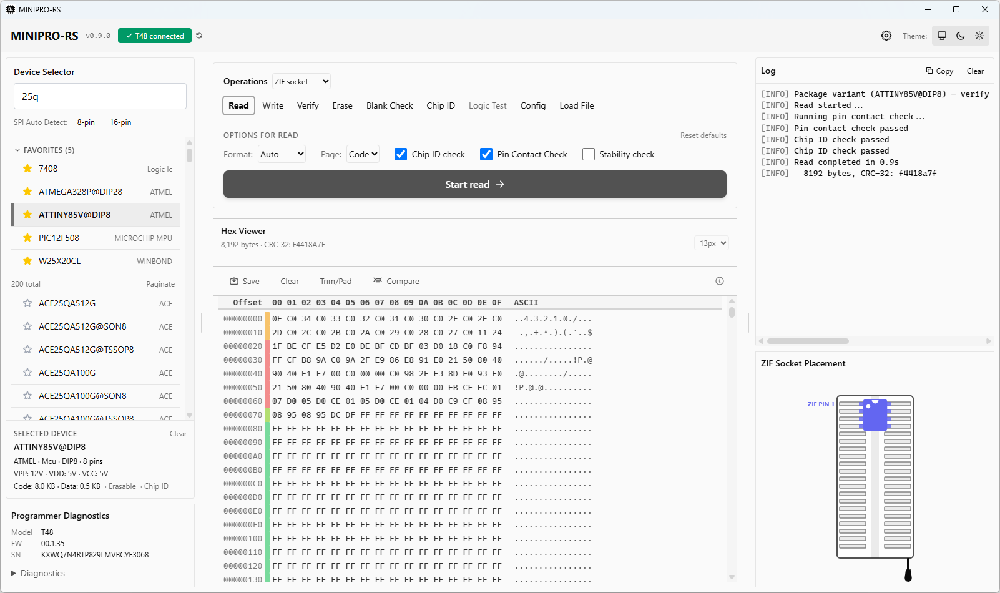
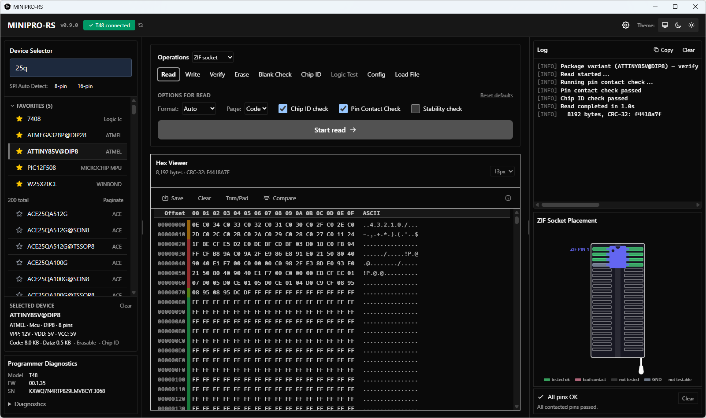

# minipro-gui

A desktop GUI for [minipro-rs](https://gitlab.com/arcturus8081/minipro-rs) built with [Tauri v2](https://tauri.app/) and [Svelte 5](https://svelte.dev/).

## Features

| Feature | Status | Description |
|---------|--------|-------------|
| **Device Search** | Done | Search the 30,000+ device database with instant results and a manufacturer column; star-toggle favorites pinned in a collapsible section — filtered to the connected programmer model since device names differ per database section (e.g. `PIC16F628A` on TL866A vs `PIC16F628A@DIP18` on T76) |
| **ICSP Wiring Diagram** | Done | Scratch-built SVG of the programmer's ICSP header wired to the selected device — header shape per model (1×6 linear, 2×8/2×14 zigzag), per-model/per-class verified pin tables, collapsible scrollable panel; CLI: `minipro -p <dev> -d` |
| **ZIF Socket Diagram** | Done | ZIF socket placement diagram for the selected device; shows insertion position and adapter guidance |
| **Device Selection** | Done | Select a device to configure operations; shows chip type, pin count, voltages |
| **Read** | Done | Read chip contents directly into hex viewer memory (optional save afterward) |
| **Write** | Done | Write a file to the chip with optional erase/verify skipping |
| **Verify** | Done | Compare chip contents against a file |
| **Erase** | Done | Erase the selected chip |
| **Blank Check** | Done | Verify the chip is blank |
| **Chip ID** | Done | Read and display the chip ID |
| **Logic Test** | Done | Test logic ICs against built-in test vectors; structured color-coded grid (Ctrl+Scroll zoom) with input/output/mismatch/ignore cell colors; copy-to-clipboard as TSV; CLI: `minipro -p 74HC00 -T` |
| **Logic IC Identify** | Done | Automatically identify an unknown logic IC by pin count; "Select a logic IC" mode with pin count buttons, VCC selector, and Identify button; results table shows only passing matches with Select/favorite/deselect; syncs with DeviceSelector; CLI: `minipro --logic-identify --pin-count N` |
| **Hex Viewer** | Done | Virtualized scrolling — instant load/clear of large files (e.g. 256KB); adjustable font size (10-16px via dropdown or Ctrl+mousewheel); Save/Open Folder/Clear buttons; in-place editing with standard hotkeys (Ctrl+S/C/V/A/Z, Ctrl+G, Ctrl+F, F3); entropy indicator; smart diff; trim/pad |
| **File Dialogs** | Done | Native OS open/save dialogs with last-used-directory persistence; save defaults to device name |
| **Progress** | Done | Live progress bar with bytes-read/written and CRC32 |
| **Terminal Log** | Done | Timestamped info/warn/error log panel with Copy to clipboard button and drag-select |
| **Settings** | Done | Persisted preferences (defaults, theme, device view mode, panel widths) via `tauri-plugin-store` |
| **Diagnostics** | Done | Programmer details, overcurrent check, hardware check |
| **Device Favorites** | Done | Star-toggle favorites persisted to localStorage; filtered per connected programmer model |
| **Context Options** | Done | Operation buttons are selectors; Start button triggers execution with per-op defaults |
| **Draggable Panels** | Done | Resize Device Selector, Hex Viewer, and Terminal with mouse drag; widths persist |
| **Layout Reset** | Done | One-click restore of panel widths, font size, and window position in Settings |
| **Hack Font** | Done | Open-source Hack monospace font bundled for hex viewer |
| **Firmware Update** | Done | Diagnostics panel + CLI (`-F`): TL866A/CS `update.dat` decryption and T48/T56/T76 family images; auto-discovers `firmware-<model>-*.dat` downloaded by the XGPro downloader, shows installed-vs-file version with downgrade/hw-revision warnings, file picker fallback |
| **Fuse Bit Decoder** | Done | Bit-level fuse/config decoder with clickable bit cells (MSB→LSB), named fields, descriptions, and dangerous-bit warnings (RSTDISBL, SPIEN, JTAGEN, DWEN). Covers all 18 AVR config variants and all database-referenced PIC config variants (12/14/16-bit). Hex input stays in sync with bit toggles. Contextual help modal explains fuse basics, bit decoder usage, and PIC code protection bits |
| **Config/Fuse Editor** | Done | Config tab auto-populates fuse/lock fields from database defaults on device select; read/write MCU configuration bytes via checkbox UI + direct hex input; "Read Config from Chip" merges real values; fuses and lock bits side-by-side |
| **Pin Contact Test** | Done | Diagnostics button and optional pre-operation gate; bad pins shown on the ZIF diagram with a color legend (tested ok / bad / not tested); GND pins rendered as untestable (can't be contact-tested by design); all-open result hints "is a chip seated?"; CLI: `minipro -z` |
| **SPI Auto Detect** | Done | "Auto Detect" buttons (8-pin / 16-pin) read the flash JEDEC ID via firmware `0x37` and list matching database devices; T76 verified, T56 implemented but gated pending hardware |
| **ICSP Mode** | Done | ZIF / ICSP / ICSP-no-VCC mode dropdown in the operations panel; ICSP-only database devices auto-enable it |
| **Voltage Overrides** | Done | Collapsible Advanced section in the Write panel with VPP/VCC/VDD dropdowns showing chip defaults; "Reset voltages" button |
| **Batch + Serial Injection** | Done | "Batch Mode" programs N identical chips with a Next-Chip flow and summary; optional auto-incrementing serial numbers (bin/ascii/bcd, endianness, step, XOR/CRC-8 checksum) patch each buffer pre-write; CLI: `--batch`, `--serial-*` |
| **Chip Health Check** | Done | Diagnostics button reads chip ID + full memory multiple times and reports a Stable / Marginal / Incomplete verdict with unstable-byte counts, worst regions, and a consensus-recovery dump save; opt-in "Stability check" checkbox on Read; CLI: `--health-check` |
| **Custom Database & Algorithm Download** | Done | Settings → Database: directory picker for custom `infoic.xml`/`logicic.xml` (live reload, persists, falls back if missing) plus a "Download algorithm.xml + firmware…" button — pure-Rust XGPro downloader, no external tools needed on Windows |

## Screenshots

**Light theme:**



**Dark theme:**



## Tech Stack

| Layer | Technology |
|-------|------------|
| **Backend** | Rust — Tauri v2, `tokio`, `minipro-core` (path dependency) |
| **Frontend** | Svelte 5 (runes), TypeScript, Vite |
| **Styling** | Tailwind CSS v4, Skeleton v3 |
| **Persistence** | `tauri-plugin-store` |
| **Dialogs** | `tauri-plugin-dialog` |
| **Build** | `cargo tauri build` (produces `.msi` + `.exe` installer on Windows) |

## Project Structure

```
gui/
├── src/
│   ├── App.svelte                    # Root layout: header + 3-column main
│   ├── app.css                       # Tailwind/Skeleton imports + custom scrollbar
│   ├── lib/
│   │   ├── file-dialog.ts            # Native open/save wrappers with defaultPath
│   │   ├── components/
│   │   │   ├── DeviceSelector.svelte   # Search + favorites + paginated/scrollable device list
│   │   │   ├── FuseBitDecoder.svelte   # Bit-level fuse/config decoder with named fields
│   │   │   ├── HexViewer.svelte        # Virtualized hex grid with font size dropdown + Ctrl+scroll
│   │   │   ├── IcspConnectorDiagram.svelte  # ICSP header + per-device wiring diagram
│   │   │   ├── IdentifyResults.svelte  # Logic-IC identify candidate table
│   │   │   ├── LogicTestGrid.svelte    # Color-coded logic test vector grid
│   │   │   ├── ProgressPanel.svelte    # Progress bar + stats
│   │   │   ├── TerminalLog.svelte      # Scrollable log output
│   │   │   ├── SettingsPanel.svelte    # Modal preferences panel
│   │   │   ├── ZifSocketDiagram.svelte # ZIF socket placement diagram
│   │   │   └── DiagnosticsPanel.svelte # Programmer info + diagnostic buttons
│   │   └── stores/
│   │       ├── batch.ts              # Batch programming state
│   │       ├── device.ts             # programmer, selectedDevice, deviceList, favorites stores
│   │       ├── hex.ts                # hexBuffer store + loadFile helper
│   │       ├── logs.ts               # Terminal log store with timestamped levels
│   │       ├── operations.ts         # doRead/doWrite/... + progress event listener
│   │       ├── settings.ts           # Persisted settings via tauri-plugin-store
│   │       └── theme.ts              # System/dark/light theme toggle
│   └── main.ts                       # Svelte mount entry point
├── src-tauri/
│   ├── src/
│   │   ├── main.rs                   # Binary entry → lib::run()
│   │   ├── lib.rs                    # App setup + command registration
│   │   ├── commands.rs               # All Tauri invoke handlers
│   │   ├── state.rs                  # Shared AppState (handle, device, db paths)
│   │   └── fuse_defs.rs              # Fuse/config bit-field definitions per MCU family
│   ├── capabilities/
│   │   └── default.json              # Tauri v2 capability manifest
│   └── Cargo.toml                    # Tauri deps + minipro-core path
├── index.html
├── package.json
├── vite.config.ts
└── tailwind.config.ts
```

## Build

### Prerequisites

- [Rust](https://rustup.rs/) 1.88+ (use rustup, not distro packages, on older distros)
- [Tauri CLI](https://tauri.app/) — install with `cargo install tauri-cli`
- [Node.js](https://nodejs.org/) (LTS)
- Windows: [Zadig](https://zadig.akeo.ie/) to install WinUSB driver (one-time)
- Linux: system libraries required by Tauri's WebKitGTK renderer and bundler:

  | Distro | Command |
  |--------|---------|
  | Debian/Ubuntu¹ | `sudo apt install libwebkit2gtk-4.1-dev libgtk-3-dev libayatana-appindicator3-dev librsvg2-dev patchelf file` |
  | Fedora | `sudo dnf install webkit2gtk4.1-devel gtk3-devel libappindicator-gtk3-devel librsvg2-devel patchelf file` |
  | Arch² | `sudo pacman -S webkit2gtk-4.1 gtk3 libappindicator librsvg patchelf file` |
  | openSUSE | `sudo zypper in webkit2gtk3-devel gtk3-devel libappindicator3-devel librsvg-devel patchelf file` |

  ¹ Also covers Linux Mint, Pop!_OS, Kali, and Parrot (Debian/Ubuntu-based).
  ² Also covers Manjaro (Arch-based).

### Download

Pre-built installers are published on the [GitHub Releases](https://github.com/Arcturus808/minipro-rs/releases) page (built from a mirror of this repo):

| Platform | Installer |
|----------|-----------|
| **Windows** | `.msi` (recommended) or `.exe` (NSIS) |
| **Linux** | `.AppImage` (universal) or `.deb` (Debian/Ubuntu) |
| **macOS** | `.dmg` (Apple Silicon) |

### Development

```bash
cd gui
npm install              # once
cargo tauri dev          # hot-reload frontend + Rust backend
```

To exercise the UI with no programmer attached, simulate a model via env var — or just pick it in Settings → Simulation:

```powershell
$env:MINIPRO_SIMULATE_PROGRAMMER = "T76"   # TL866A, TL866CS, TL866II+, T48, T56, T76
cargo tauri dev
Remove-Item Env:MINIPRO_SIMULATE_PROGRAMMER  # restore real-hardware detection
```

### Production Build

```bash
cd gui
cargo tauri build
```

Output:
- `src-tauri/target/release/bundle/msi/MINIPRO-RS_<version>_x64_en-US.msi`
- `src-tauri/target/release/bundle/nsis/MINIPRO-RS_<version>-setup.exe`

### Chip Database

The **production installer bundles `infoic.xml` and `logicic.xml`** — end users do not need to download them separately.

For **development**, copy them next to the built `.exe` so the database resolver can find them (the resolver's exe-directory lookup — the dev-build `data/` check expects `<exe>/../../data`, which doesn't exist under `src-tauri/target/`):

```powershell
Copy-Item src-tauri\resources\infoic.xml src-tauri\target\debug\
Copy-Item src-tauri\resources\logicic.xml src-tauri\target\debug\
# and again under target\release\ for release builds
```

Or place them in any other searched location (`MINIPRO_HOME`, per-user data dir, etc.) — see [CLI and TUI setup](../README.md#cli-and-tui-setup) for the full search-path table.

## Architecture

### Frontend State Management

Svelte 5 runes (`$state`, `$derived`) are used for local component state. Cross-component state lives in module-level stores under `src/lib/stores/`:

- **`device.ts`** — `programmer` (connection info), `selectedDevice`, `deviceList`, `dbAvailable`
- **`operations.ts`** — `isRunning` flag, `activeOperation`, `doRead`/`doWrite`/... async action wrappers, `initProgressListener()` that listens for `"progress"` events from the backend
- **`settings.ts`** — `settings` object persisted via `tauri-plugin-store`, `initSettings()` loads on app startup
- **`logs.ts`** — `logs` array with `info()`/`warn()`/`error()` helpers; `TerminalLog.svelte` subscribes and auto-scrolls
- **`hex.ts`** — `hexBuffer` for the hex viewer; `loadFile()` reads a file via `invoke("read_file_bytes")`

### Backend Commands

All USB/programmer operations are exposed as async Tauri commands in `src-tauri/src/commands.rs`:

| Command | What It Does |
|---------|-------------|
| `get_programmer_info` / `force_reconnect` | Detect connected programmer (model/firmware/serial); drop and re-open a stale USB handle |
| `search_devices` / `get_device_info` / `get_device_pin_map` | Query `infoic.xml` by name; fetch device details and ZIF placement data |
| `check_favorite_devices` | Report which favorites' names resolve for the connected model |
| `select_device` / `deselect_device` | Resolve/select a `Device` for the connected model |
| `get_icsp_wiring` / `get_zif_layout` | ICSP wiring table + connector pinout; ZIF socket layout for the diagrams |
| `get_voltage_options` | VPP/VCC/VDD override choices for the Write panel |
| `do_read` / `do_write` / `do_verify` | High-level chip operations with progress events |
| `do_write_bytes` / `do_batch_write_chip` | Write from an in-memory buffer; batch write with optional serial patching |
| `do_erase` / `do_blank_check` / `do_chip_id` | Chip control operations |
| `do_pin_test` / `do_spi_autodetect` | Pin-contact check; SPI flash JEDEC autodetect |
| `read_chip_to_bytes` | Read chip to memory and return as base64 (for hex viewer) |
| `read_file_bytes` / `save_bytes_to_file` / `save_buffer_to_file` / `file_exists` / `open_folder` | File I/O for hex viewer, save dialogs, and folder reveal |
| `read_fuses` / `write_fuses` / `read_calibration` / `check_lock_protection` / `get_fuse_bit_defs` | Config/fuse/lock-byte operations and decoder definitions |
| `do_logic_test` / `do_logic_identify` | Logic IC vector test; unknown-IC identification |
| `run_health_check` | Multi-pass chip read-stability analysis |
| `do_smart_diff` | Byte-level buffer-vs-file comparison |
| `check_database` / `get_db_status` / `set_custom_db_dir` | Verify databases are locatable; report search-path status; set custom DB directory |
| `download_algorithms` / `cancel_algo_download` / `find_downloaded_firmware` / `open_download_dir` | XGPro algorithm/firmware downloader |
| `get_programmer_details` / `check_overcurrent` / `run_hardware_check` / `do_firmware_update` | Diagnostics: details, OVC registers, self-test, firmware update |
| `get_dynamic_window_size` | Monitor-aware initial window sizing |

Commands that access USB use `tokio::task::spawn_blocking` to avoid blocking Tauri's async executor.

### Progress Events

Long-running operations emit `"progress"` events via `window.emit()`:

```rust
window.emit("progress", ProgressPayload { done, total, operation: "read".into() })?;
```

The frontend `operations.ts` listens and updates `progress` / `isRunning` stores, which `ProgressPanel.svelte` and operation buttons react to.

## Development Notes

### WebView2 Thread Sensitivity (Windows)

On Windows, Tauri uses the system's WebView2 (Edge) renderer. Complex reactive updates — especially rendering large lists with Svelte's `{#each}` — can freeze the UI thread. We encountered this during device search with 200+ results and hex viewer with 16,000+ rows.

**Mitigations applied:**
- **Paginated list rendering** (12 items per page) with a "Paginate / Scroll" toggle
- **Virtualized hex viewer** — only renders visible rows (~30) instead of all 16,000; instant load/clear of 256KB files
- Avoid `flex`/`card` wrapper classes in small panels (e.g., DiagnosticsPanel) — use minimal Tailwind utilities
- Keep reactive computations simple; offload heavy work to the backend

### Device Favorites & Programmer Models

Favorites live in a shared `favorites` store (`stores/device.ts`) persisted
to `localStorage`. The chip database is split into per-programmer-family
sections with different naming — the TL866A section has bare names like
`PIC16F628A` while T76 only has package-qualified names like
`PIC16F628A@DIP18`. A favorite saved under one model may therefore not
resolve under another, so the favorites section hides entries that don't
exist in the connected model's device list (`check_favorite_devices`
command → `list_devices_by_model()` in `minipro-core`). Hidden favorites
stay in the store and reappear when a compatible programmer is connected;
searching the base name finds the model-specific variant to favorite
instead.

### Two-Step Operation Flow

Operation buttons (Read, Write, Verify, etc.) are **selectors**, not immediate triggers:

1. **Select** an operation — the button highlights, relevant options appear below
2. **Configure** options (Page, Format, etc.) — only controls relevant to that operation are shown
3. **Click Start** — the actual execution begins, with per-operation defaults applied automatically

This prevents accidental one-click operations and lets users review settings before committing.

### Hex Viewer

The hex viewer renders chip dumps and files with three columns (offset, hex bytes, ASCII) using `ch` units so spacing stays proportional at any font size. It uses the **Hack** open-source monospace font for clean character distinction.

**Features:**
- **Virtualized rendering** — only visible rows are rendered (~30 at a time); clearing 256KB is instant
- **Font size** — 10px to 16px via dropdown; Reset button returns to 13px default
- **Save** — writes the in-memory buffer to disk; dialog defaults to the selected device name (e.g. `W25X20CL_SOIC8.bin`)
- **Open Folder** — opens the save location in Explorer/Finder
- **Clear** — wipes the memory buffer
- **In-place editing** — click any hex byte or ASCII character to edit; type-through overflow, keyboard navigation (arrows, Enter, Escape, Backspace)
- **Standard hotkeys** — Ctrl+S (save), Ctrl+C/V (copy/paste bytes), Ctrl+A (select all), Ctrl+Z/Shift+Z/Y (undo/redo), Ctrl+Home/End (jump to start/end), Tab (switch hex/ASCII panes), Ctrl+G (go to offset)
- **Find/search** — Ctrl+F opens find dialog with hex and ASCII search modes; F3/Shift+F3 navigates matches
- **Entropy indicator** — per-row Shannon entropy bar in the gutter; green=uniform, red=high entropy; toggle in Settings (off by default)
- **Smart firmware diff** — compare buffer against a reference file with three-way tail classification; F3/Shift+F3 navigates diffs
- **Manual trim/pad** — trim trailing fill bytes or pad to a target size
- **Unsaved changes protection** — prompts before overwriting pending edits or unsaved buffer changes
- **Help overlays** — hex viewer (?/F1 or "i" icon) and config/fuses panel ("i" icon) both have contextual help modals

### Theme System

The app supports System / Dark / Light themes. Skeleton's `preset-filled-surface-100-900` classes adapt automatically. For custom modals that need explicit backgrounds, we use `$derived` from `$settings.theme` rather than Tailwind's `dark:` prefix, because `@custom-variant dark (&:is(.dark *))` is required in `app.css` for the `dark:` variant to work with Skeleton's theme class toggling.

### Settings Persistence

`tauri-plugin-store` writes to the app's data directory (e.g., `%APPDATA%/minipro-gui/settings.json` on Windows). Settings include:

- Default operation options (skip erase/verify, page, format, size mismatch)
- Theme preference
- Device list view mode (paginated vs scroll)
- Hex viewer font size
- Entropy indicator toggle
- Panel widths (Device Selector, Terminal)
- Last-used directory for file dialogs

A **Reset layout & font size** button in Settings restores all of the above to factory defaults and re-centers the window.

## Roadmap

- [x] Phase 1 — Core operations + progress + basic layout
- [x] Phase 2 — Hex viewer + file I/O + device search
- [x] Phase 3 — Diagnostics (overcurrent, hardware check, programmer details)
- [x] Phase 3.5 — Two-step operations, context-aware options, ComboSearch with favorites
- [x] Phase 4 — Firmware update (TL866A/CS `update.dat` decryption)
- [x] Phase 5 — Pin test integration
- [x] Phase 6 — ICSP wiring diagrams (per-model connector + per-class wiring)

*(Phases 3, 3.5, and 5 were completed out of order.)*

## Third-Party Licenses

The **Hack** monospace font is bundled under the MIT License and Bitstream Vera License. See [`gui/public/fonts/LICENSE-Hack.md`](public/fonts/LICENSE-Hack.md).

## License

Same as the parent project: see [../LICENSE](../LICENSE).
